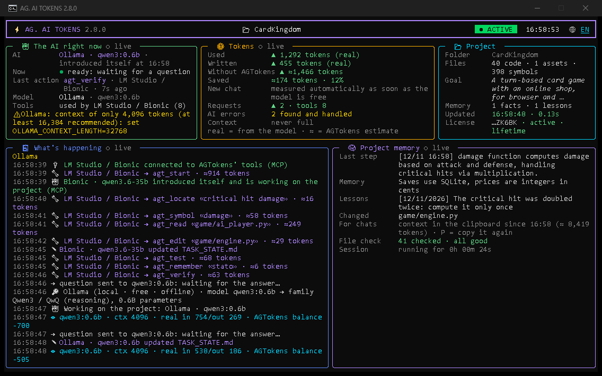
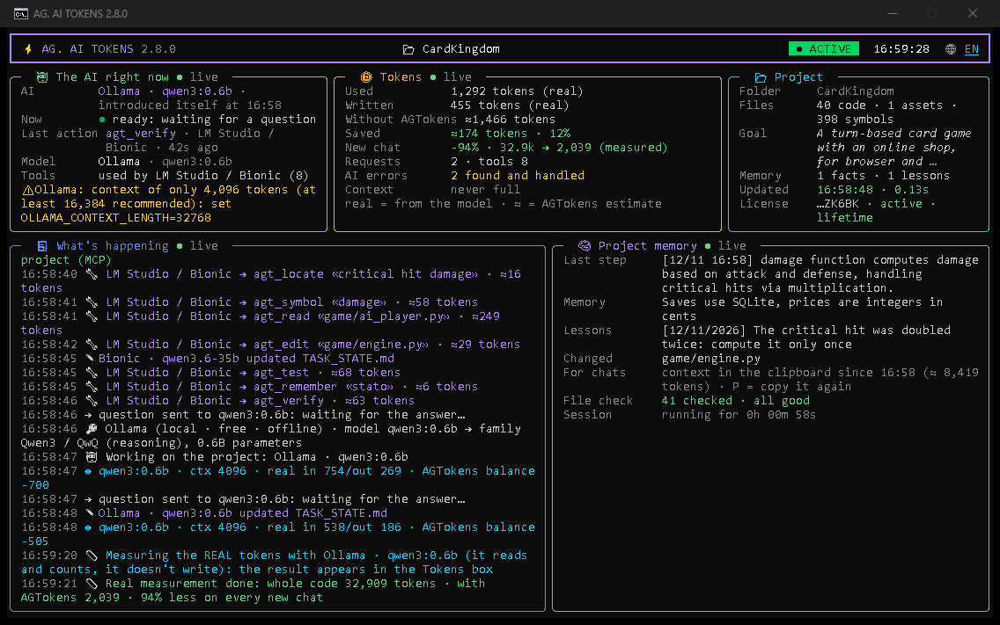
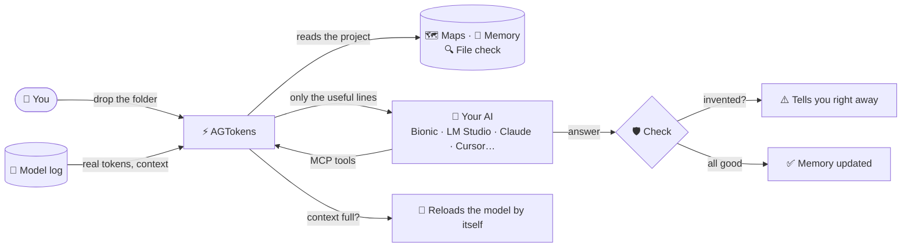

<p align="center">
  
</p>

<p align="center">
  <a href="https://github.com/cPeps/AGTokens/releases/latest"></a>
  
  
  
  
  <a href="https://github.com/cPeps/AGTokens/releases/latest"></a>
</p>

<p align="center">
  <b>🦁 Built for the <i>Leone San Marco</i> community and the game it is developing.</b><br>
  <sub>by DevPeps · <a href="https://github.com/cPeps/AGTokens/wiki">📖 Wiki</a> · <a href="https://github.com/cPeps/AGTokens/discussions">💬 Discussions</a> · <a href="#-activation-keys-free-limited">🔑 Free keys</a></sub>
</p>

---

## ⚡ In one sentence

**AG. AI TOKENS** gives your AI **project memory, code maps, answer verification and automatic fixes**, so it stops forgetting, stops inventing files and stops wasting tokens. Drop your project folder on the icon and **you're done**: it updates itself, shows everything live, and reopens by itself whenever you open your AI.

### Who is it for?

- 🎮 **Game and app developers** who code with AI on their own PC (Bionic, LM Studio, Ollama, Unsloth…), with Unreal, Unity, Godot or Blender.
- 💸 People who use **free or local models** and are tired of tiny context windows, loops and empty answers.
- 🧾 People who use **paid AIs** (Claude, ChatGPT, Cursor) and hit **usage limits** too fast: fewer tokens per task means more work before the limit.

<p align="center">
  
  <br><sub>The real AGTokens window while an AI uses its tools and a local model answers through it: everything live, no keys to press.</sub>
</p>

---

## 😤 The problems it solves

These are the most common problems people report with AI coding assistants, local and paid:

| Problem | What AGTokens does |
|---|---|
| 🧠 **The AI forgets** what you decided yesterday | Project memory, work state and lessons learned: every AI finds them again in every session |
| 🔍 **It re-reads the whole project** and burns thousands of tokens | Code maps and tools that read **only the lines that matter** (on a real project: **‑95% tokens** per new chat, measured with the model's own tokenizer) |
| 🤥 **It invents** files, lines, functions, "tests pass" | Every answer is **checked against the real project** |
| 💥 *"The selected model ran out of context space"* | AGTokens **reloads the model the right way by itself** (Bionic / LM Studio) |
| ✂️ **Ollama silently cuts long prompts** (4K default context) | AGTokens detects it, warns you and tells you the exact fix |
| 🔁 The AI **loops**: same tool call again and again (seen live: 137× the same `create_folder` in Bionic) | Detected in AGTokens' tools **and in the Bionic chat**: warning at 3, the model is **stopped automatically** at 6 |
| 🤐 "Thinking" models (Qwen3, DeepSeek‑R1…) **answer empty** | The answer is recovered automatically (more room, then reasoning off) |
| 🧩 Small models write tool calls **as plain text** / broken JSON | Tool calls and JSON are repaired |
| 📁 **Duplicate** files, `(1)` copies, missing files | **File check** as soon as you open the project |
| 💳 **Usage limits** of paid plans reached too fast | Fewer tokens per task: targeted reads, compact context, capped tool outputs |

---

## ✨ Key features

- 🖥️ **One live, colorful window**: what the AI is doing *right now* (reading your message, writing the answer, tokens per second, last tool used), context in use, every event explained. **No keys to press.**
- 📊 **Honest token numbers**: tokens really used, how many **without AGTokens**, how many **saved**, and the **measured** saving per new chat (see below).
- 🤖 **Sees everything the model does**: with Bionic and LM Studio it reads the model's own log, so even the app's built‑in chat is counted (never twice).
- 🔧 **Fixes the model by itself**: context split across parallel requests or too small → it reloads the model when idle (never in the middle of an answer).
- 🧩 **MCP tools** for AIs that support them: find code, read only the useful lines, precise edits (`agt_edit`), run the **real tests** (`agt_test`), syntax check after every change, loop guard.
- 🛡️ **Answer verification**: invented files, wrong line numbers, functions that don't exist, "lazy" code (`// ... rest unchanged`).
- 🔍 **Project file check**: scripts with errors, files referenced but missing, duplicates, old copies.
- 🔁 **Reopens by itself** when you open your AI, on the right project.
- 💾 **Memory is never lost**: if you delete AGTokens' files by mistake, they come back with their content.
- 🗂️ **Your files are safe**: before an AI changes an existing file through AGTokens' tools, a safety copy is kept in `_ai_context/_backup/` (last 5 per file). Windows line endings are preserved; AGTokens' internal files and `.git` cannot be overwritten.
- 🔁 **Stops loops in the Bionic chat too**: AGTokens reads the chat (read-only), warns after 3 identical actions in a row and **stops the model by itself after 6**.
- 🎮 **Made for game developers**: Unreal, Unity, Godot and **Blender scenes** read without opening binary files.
- 🌐 **English or Italian**: click **🌐** at the top right (or press **L**) to switch at any time.
- 🔔 **Windows notifications** for what matters · ⬆️ **automatic, signed updates**.

<p align="center">
  
  <br><sub>Tokens used and saved, context in use, connected tools, file check and project memory.</sub>
</p>

---

## 📊 Honest token numbers

AGTokens never shows a number it cannot back up. In the **🪙 Tokens** box:

| Row | Meaning | Source |
|---|---|---|
| **Used** | Tokens the model really read | **Real** — counted by the model itself (log of Bionic/LM Studio or the model's API) |
| **Written** | Tokens of the answers | **Real** |
| **Without AGTokens** | What the model would have had to read without AGTokens | Used + Saved |
| **Saved** | Tokens avoided by targeted reads, compact context and compressed history, minus what AGTokens adds. A targeted read is worth at most the difference with reading that file **once**, and the saving goes down if the AI re-reads the same file. The context for web chats counts only when it was **really pasted** (an answer came back), not just copied | **Estimate** (marked with ≈) |
| **New chat** | Whole project vs AGTokens context, counted by **your model's tokenizer** | **Measured** |

Each request is counted **once**, even when it passes through both the proxy and the model's log, and retries are included, because they really cost tokens.

> [!NOTE]
> **2.8.0 — "no lies" release.** Every feature was re‑tested from the outside against reality (177 independent checks with a detailed log, also with a real model). Savings that were over‑counted are now counted honestly, the answer checker no longer accuses honest answers, and the AI is never told something false about your project.

---

## 🤝 Works with

| Type | AI | How it connects |
|---|---|---|
| 💻 **On your PC (free, offline)** | **Bionic**, LM Studio, Ollama, Jan, GPT4All, llama.cpp, vLLM, KoboldCpp, Unsloth Studio | MCP tools + local proxy + reading the model's log |
| 🧑‍💻 **Agents** | Claude Code, Cursor, Windsurf, Cline, AnythingLLM | MCP tools (configured automatically) |
| ⌨️ **Free terminal AIs** | **OpenCode** (tested end‑to‑end), Kilo Code CLI, Crush, Qwen Code, Antigravity CLI / Gemini CLI, Codex CLI | MCP tools (configured automatically, each in its own format) |
| 💬 **Chats** | Claude Desktop, ChatGPT, Gemini, DeepSeek, Mistral, Grok… | MCP where available, otherwise the project context is ready in your clipboard + automatic check of the answers you copy |

AGTokens **recognizes which AI you are using** and adapts its rules to that AI's known weaknesses (small models, reasoning models, chats without file access…).

---

## 🧭 How it works



---

## 🚀 Tutorial: from zero to ready in 2 minutes

1. **Download** the latest version from [**Releases**](https://github.com/cPeps/AGTokens/releases/latest) → `AGTokens_v2.8.0.zip`.
2. **Extract** the zip anywhere (for example on your Desktop).
3. **Drag your project folder** onto `AGTokens.exe`.
4. On first launch **choose your language** (🇬🇧 English / 🇮🇹 Italiano) and paste your **activation key** ([how to get one](#-activation-keys-free-limited)).
5. **That's it.** Open your AI (Bionic, LM Studio, Claude…) and work as usual:
   - AIs with MCP tools get them **automatically**;
   - for web chats the project context is **already in your clipboard**: paste it once at the start;
   - next time you open your AI, **AGTokens reopens by itself**.

> [!TIP]
> With **Bionic / LM Studio** there is nothing to configure: AGTokens connects its tools, starts the model server if it is off, and fixes the context if the model was loaded badly. More guides in the [**Wiki**](https://github.com/cPeps/AGTokens/wiki).

---

## 🔑 Activation keys: free, limited

AGTokens **needs a personal activation key** to run (one key = one PC). Without a key the program does not start.

### 🎟️ Free of charge
Keys are **free**: you don't pay anything. You just ask for one.

### 📉 Limited number of keys
Only a **limited number of keys** is available. Requests are handled **in order of arrival**, while supplies last. When the keys run out, no new keys are given until further notice.

### ⏳ Limited time of use
Each key works for a **limited period of time**. The window always shows how much time is left (for example *"expires in 6d 4h"*), and AGTokens notifies you **3 days, 24 hours and 1 hour** before it expires. When a key expires, the program stops working until the key is renewed.

### 📝 How to request a key
1. Open a [**key request**](https://github.com/cPeps/AGTokens/issues/new?template=richiesta_chiave.yml).
2. Leave **only a nickname** (Discord or Telegram): the page is public.
3. You receive the key **privately**. Paste it on first launch.

> [!IMPORTANT]
> Never post personal data (email, phone) or your key in public issues. A key is personal: it works on one PC only and must not be shared.

---

## 🔒 Security & privacy

- Your projects, your code and your conversations with the AI **stay on your PC**. The proxy accepts **local models only**.
- The local proxy answers **only programs on your PC**: requests from web pages (including "DNS rebinding" tricks) are refused.
- The AI tools cannot read or write **outside your project**.
- The only internet connection is the **license check**: the server receives only the key, an anonymous PC fingerprint (not reversible), the program version, the fingerprint of the program file (to recognize modified copies) and the proof that you accepted the Terms (version and fingerprint of the texts, date). No files, no names, no IP addresses stored.
- License answers and updates are **digitally signed** by the server (Ed25519): a fake server or a modified update is rejected.
- Found a vulnerability? Please report it **privately**: see [SECURITY.md](SECURITY.md).

---

## ⚖️ Legal

By using AGTokens you accept the **[Terms of Use (EULA)](legal/EULA_en.md)** and the **[Privacy Notice](legal/PRIVACY_en.md)**. You accept them **simply by using the program**: nothing to type. On first launch (and whenever the texts change) the window shows a clear notice with a summary and where to read them in full; a receipt and a copy of the texts stay on your PC. The **Italian texts are authoritative**: [Condizioni d'uso](legal/EULA_it.md) · [Informativa privacy](legal/PRIVACY_it.md).

In short:
- AGTokens is **free** and **proprietary**, provided **"as is"**, without warranties. The licensor is not liable for damages except where the law does not allow excluding it (wilful misconduct or gross negligence).
- **You** are responsible for your projects, the changes you accept and the content produced with AIs. **Keep backups.**
- The **Leone San Marco community**, its administrators, moderators and managers are **not parties** to the license and are **not responsible** for the program.
- AGTokens is **not affiliated with** Anthropic, OpenAI, LM Studio, Bionic, Ollama, Unsloth, Cursor, Epic Games, Unity, Godot, the Blender Foundation, Cloudflare or GitHub. All trademarks belong to their owners.
- Third‑party components and their licenses: [THIRD_PARTY_NOTICES](legal/THIRD_PARTY_NOTICES.txt).

---

## 🛡️ "Windows protected your PC"? Here's why

`AGTokens.exe` **is not code‑signed**: a code‑signing certificate costs hundreds of euros per year and this is a community project. That's why **Windows SmartScreen** may show a warning on first launch.

To run it: click **"More info" → "Run anyway"**.

To make sure you have the original file:
- download it **only** from this [Releases](https://github.com/cPeps/AGTokens/releases/latest) page;
- compare the SHA‑256 fingerprint with the one in the release's `.sha256` file:
  ```powershell
  Get-FileHash .\AGTokens_v2.8.0.zip -Algorithm SHA256
  ```
- AGTokens itself checks that it is an **original copy**: a modified copy is blocked.

---

## ❓ FAQ

<details>
<summary><b>Do I need to press keys or configure anything?</b></summary>
No. You just read the window: everything updates by itself. Optional: click 🌐 (or press L) to change language; press P to put the project context back in the clipboard when you open a new web chat. The only thing you may ever type is the API key of a protected model (e.g. Unsloth Studio), and the input line opens by itself.
</details>

<details>
<summary><b>Does it work offline?</b></summary>
Yes, with local models. The license stays valid offline for the period set by the owner (usually 24 hours), then a connection is needed for the next check.
</details>

<details>
<summary><b>How many tokens do I really save?</b></summary>
AGTokens measures it with your model's tokenizer: on its own code (≈170,000 tokens) the context it prepares is ≈8,800 tokens, i.e. <b>‑95% for every new chat</b>. On tiny projects the saving is small, and the window tells you so honestly.
</details>

<details>
<summary><b>Does it help with Claude / ChatGPT / Cursor usage limits?</b></summary>
Yes: their agents read only the lines they need through AGTokens' tools instead of whole files, tool outputs are capped, and new chats start from a compact context instead of the whole project.
</details>

<details>
<summary><b>My antivirus flags it.</b></summary>
This happens with unsigned single‑file programs. Download it only from Releases and verify the SHA‑256 fingerprint. Feel free to open a <a href="https://github.com/cPeps/AGTokens/issues/new?template=bug_report.yml">report</a>.
</details>

<details>
<summary><b>Is the source code available?</b></summary>
No: AGTokens is proprietary software and runs only with an activation key. Here you'll find the program, the guides and the channels for reports and ideas.
</details>

---

## 🐞 Bugs, ideas and feedback

- 🐞 [**Report a bug**](https://github.com/cPeps/AGTokens/issues/new?template=bug_report.yml)
- 💡 [**Suggest an idea**](https://github.com/cPeps/AGTokens/issues/new?template=feature_request.yml)
- 🔑 [**Request a key**](https://github.com/cPeps/AGTokens/issues/new?template=richiesta_chiave.yml) (free, limited)
- 💬 [**Discussions & questions**](https://github.com/cPeps/AGTokens/discussions) · 📖 [**Wiki**](https://github.com/cPeps/AGTokens/wiki)

---

## 📋 Requirements

- Windows 10 or 11 (64‑bit)
- An AI: **Bionic** or **LM Studio** with a local model is recommended (free); Claude, ChatGPT, Cursor and others work too
- Optional: Blender (to read `.blend` scenes), Node.js (more accurate JavaScript checks)

---

<p align="center">
  🦁 Made with passion for the <b>Leone San Marco</b> community and its game.<br>
  <sub>© 2026 DevPeps — proprietary software, activation key required. See <a href="LICENSE">LICENSE</a>.</sub>
</p>
