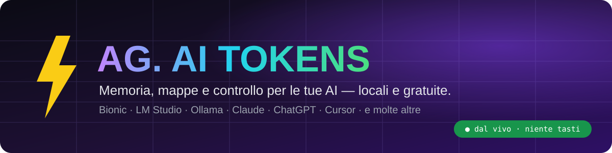
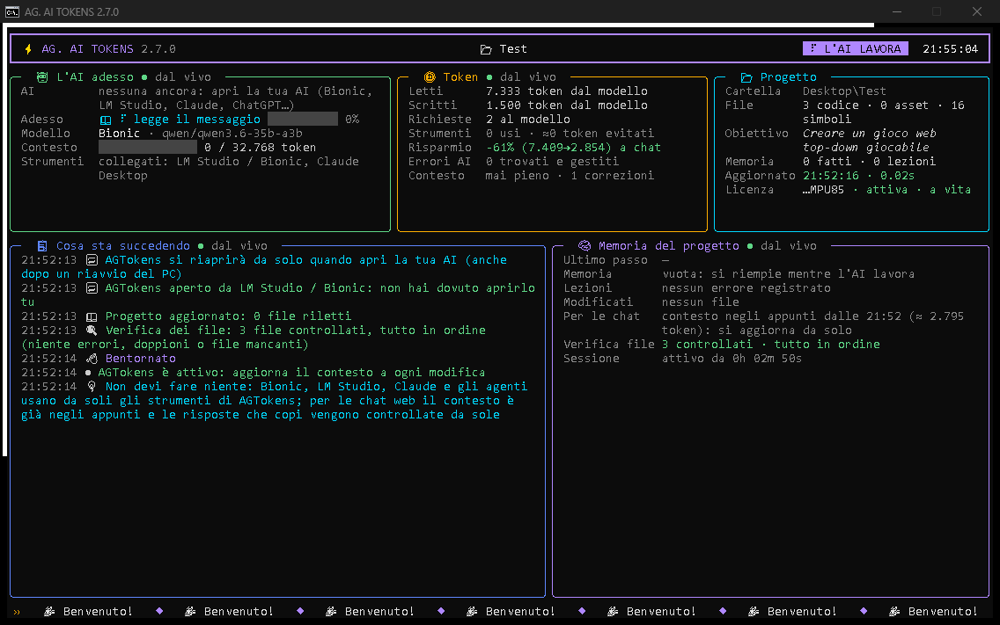
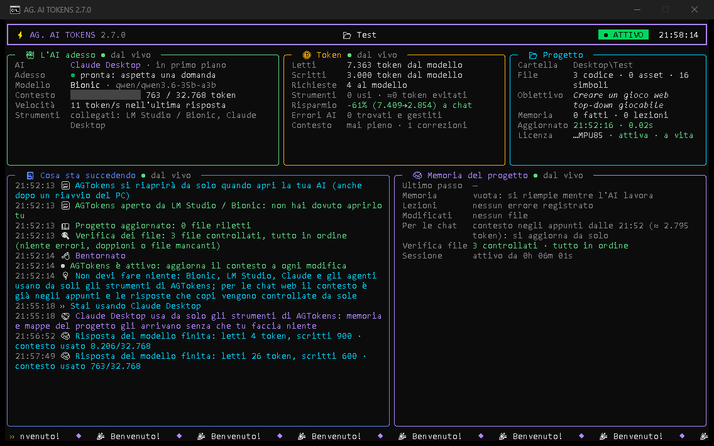
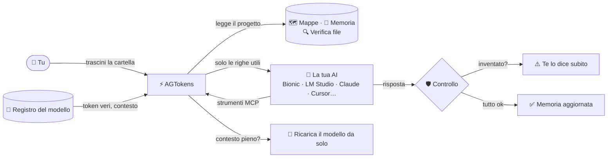

<p align="center">
  
</p>

<p align="center">
  <a href="https://github.com/cPeps/AGTokens/releases/latest"></a>
  
  
  
  <a href="https://github.com/cPeps/AGTokens/releases/latest"></a>
</p>

<p align="center">
  <b>🦁 Creato per la community <i>Leone San Marco</i> e per il gioco che sta sviluppando.</b><br>
  <sub>by DevPeps</sub>
</p>

---

## ⚡ In una frase

**AG. AI TOKENS** dà alla tua intelligenza artificiale **memoria del progetto, mappe del codice, controllo delle risposte e correzione automatica dei problemi**, così l'AI non dimentica, non inventa file e non spreca token. Trascini la cartella del progetto sull'icona e **non devi fare altro**: si aggiorna da solo, si vede tutto dal vivo, si riapre da solo quando apri la tua AI.

<p align="center">
  
  <br><sub>La finestra di AGTokens mentre Qwen 3.6 (in Bionic) legge il messaggio: tutto dal vivo, nessun tasto da premere.</sub>
</p>

---

## 😤 Il problema che risolve

Chi lavora con le AI (soprattutto quelle **gratuite che girano sul PC**) conosce bene questi problemi:

| Problema | Cosa fa AGTokens |
|---|---|
| 🧠 **L'AI dimentica** cosa avete deciso ieri | Memoria del progetto, stato del lavoro e lezioni sugli errori: ogni AI li ritrova a ogni sessione |
| 🔍 **Rilegge tutto il progetto** e consuma migliaia di token | Mappe del codice e strumenti che leggono **solo le righe che servono** (su un progetto vero: **‑95% di token** a ogni nuova chat, misurati col tokenizer del modello) |
| 🤥 **Inventa** file, righe, funzioni, "i test passano" | Ogni risposta viene **controllata contro il progetto vero** |
| 💥 *«The selected model ran out of context space»* | AGTokens **ricarica da solo** il modello nel modo giusto (Bionic / LM Studio) |
| ✂️ *«Unterminated string in JSON»*, risposte troncate | I file vengono scritti **a pezzi**, le risposte troncate vengono completate |
| 🔁 L'AI va in **loop** o risponde **vuoto** | Loop fermati, risposte vuote dei modelli che "ragionano" recuperate da sole |
| 📁 File **doppi**, copie `(1)`, file mancanti | **Verifica dei file** appena entri nel progetto: errori, doppioni, file mancanti |

---

## ✨ Funzioni principali

- 🖥️ **Finestra unica, a colori, dal vivo**: cosa sta facendo l'AI *in questo istante* (legge il messaggio, scrive la risposta, token al secondo), quanto contesto usa, token letti e scritti, eventi spiegati in italiano. **Nessun tasto da premere.**
- 🤖 **Vede tutto quello che fa il modello**: con Bionic e LM Studio legge il registro del modello, quindi conta anche la chat interna dell'app.
- 🔧 **Sistema da solo il modello**: contesto diviso fra più richieste o troppo piccolo → lo ricarica quando è libero (mai a metà di una risposta).
- 🧩 **Strumenti MCP** per le AI che li supportano: trova il codice, legge solo le righe utili, modifica con precisione (`agt_edit`), esegue i **test veri** (`agt_test`), controlla la sintassi dopo ogni modifica.
- 🛡️ **Verifica delle risposte**: file inventati, righe sbagliate, funzioni che non esistono, codice "pigro" (`// ... resto invariato`).
- 🔍 **Verifica dei file del progetto**: script con errori, file richiamati ma mancanti, doppioni, copie vecchie.
- 🔁 **Si riapre da solo**: quando apri la tua AI, AGTokens si riapre sul progetto giusto.
- 💾 **La memoria non si perde**: se cancelli per sbaglio i file di AGTokens, tornano con il loro contenuto.
- 🎮 **Per chi fa giochi**: Unreal, Unity, Godot e **scene Blender** lette senza aprire i file binari.
- 🔔 **Notifiche di Windows** per le cose importanti.
- ⬆️ **Aggiornamenti automatici e firmati**: non devi scaricare niente due volte.

<p align="center">
  
  <br><sub>Token letti e scritti dal modello, contesto usato, strumenti collegati, verifica dei file e memoria del progetto.</sub>
</p>

---

## 🤝 Funziona con

| Tipo | AI | Come si collega |
|---|---|---|
| 💻 **Sul tuo PC (gratis, offline)** | **Bionic**, LM Studio, Ollama, Jan, GPT4All, llama.cpp, vLLM, KoboldCpp, Unsloth Studio | Strumenti MCP + proxy locale + lettura del registro del modello |
| 🧑‍💻 **Agenti** | Claude Code, Cursor, Windsurf, Cline, Gemini CLI, AnythingLLM | Strumenti MCP (configurati da soli) |
| 💬 **Chat** | Claude Desktop, ChatGPT, Gemini, DeepSeek, Mistral, Grok… | MCP dove disponibile, altrimenti contesto pronto negli appunti + controllo automatico delle risposte copiate |

AGTokens **riconosce quale AI stai usando** e adatta le regole ai suoi problemi noti (modelli piccoli, modelli che ragionano, chat senza accesso ai file…).

---

## 🧭 Come funziona



---

## 🚀 Tutorial: da zero a pronto in 2 minuti

1. **Scarica** l'ultima versione dalla pagina [**Releases**](https://github.com/cPeps/AGTokens/releases/latest) → `AGTokens_v2.7.0.zip`.
2. **Estrai** lo zip dove vuoi (per esempio sul Desktop).
3. **Trascina la cartella del tuo progetto** sull'icona di `AGTokens.exe`.
4. Al primo avvio incolla la tua **chiave di attivazione** (vedi sotto come ottenerla).
5. **Fine.** Apri la tua AI (Bionic, LM Studio, Claude…) e lavora come sempre:
   - le AI con gli strumenti MCP li ricevono **da sole**;
   - per le chat web il contesto del progetto è **già negli appunti**: incollalo una volta all'inizio;
   - la prossima volta che apri la tua AI, **AGTokens si riapre da solo**.

> [!TIP]
> Con **Bionic / LM Studio** non serve configurare niente: AGTokens collega da solo gli strumenti, accende il server del modello se è spento e sistema il contesto se è caricato male.

---

## 🔑 Chiave di attivazione

AGTokens funziona con una **chiave personale** (una chiave = un PC).

- 🆓 **Oggi la chiave è gratuita**: chiedila aprendo una [**richiesta di chiave**](https://github.com/cPeps/AGTokens/issues/new?template=richiesta_chiave.yml).
- 🔮 In futuro le chiavi potrebbero diventare **seriali a pagamento** oppure restare **gratuite su richiesta**: chi ha già una chiave verrà avvisato direttamente nella finestra del programma.
- ⏳ La finestra mostra sempre lo stato della chiave e il tempo che resta.

> [!IMPORTANT]
> Non scrivere mai dati personali (email, telefono) nelle segnalazioni pubbliche: nel modulo indica solo un nickname (Discord/Telegram) con cui contattarti.

---

## 🛡️ «Windows ha protetto il PC»? Ecco perché

`AGTokens.exe` **non ha la firma digitale di Windows**: un certificato di firma del codice costa centinaia di euro l'anno e per ora il progetto resta gratuito. Per questo **Windows SmartScreen** può mostrare un avviso al primo avvio.

Per avviarlo: clicca **«Ulteriori informazioni» → «Esegui comunque»**.

Per essere sicuro di avere il file originale:
- scaricalo **solo** da questa pagina [Releases](https://github.com/cPeps/AGTokens/releases/latest);
- confronta l'impronta SHA‑256 con quella pubblicata nel file `.sha256` della release:
  ```powershell
  Get-FileHash .\AGTokens_v2.7.0.zip -Algorithm SHA256
  ```
- AGTokens stesso verifica di essere una **copia originale**: una copia modificata viene bloccata.

---

## 🔒 Privacy

- I tuoi progetti, il codice e le conversazioni con le AI **restano sul tuo PC**. Il proxy accetta **solo** modelli locali.
- L'unico collegamento a internet è il **controllo della licenza**: al server vanno solo la chiave, un'impronta anonima del PC (non reversibile) e la versione del programma. Nessun file, nessun nome, nessun indirizzo IP salvato.

---

## ❓ Domande frequenti

<details>
<summary><b>Devo premere dei tasti o configurare qualcosa?</b></summary>
No. La finestra si legge e basta: tutto si aggiorna da solo. L'unica cosa da scrivere, solo se serve, è la chiave API di un modello protetto (es. Unsloth Studio): la riga si apre da sola.
</details>

<details>
<summary><b>Funziona senza internet?</b></summary>
Sì, con i modelli locali. La licenza resta valida anche senza connessione per il periodo stabilito dal titolare (di solito 24 ore), poi serve una connessione per il ricontrollo.
</details>

<details>
<summary><b>Quanti token risparmio davvero?</b></summary>
AGTokens lo misura col tokenizer del tuo modello: sul suo stesso codice (≈170.000 token) il contesto preparato da AGTokens è di ≈8.800 token, cioè <b>‑95% a ogni nuova chat</b>. Sui progetti molto piccoli il risparmio è minimo, e la finestra te lo dice onestamente.
</details>

<details>
<summary><b>Il mio antivirus lo segnala.</b></summary>
Succede ai programmi senza firma digitale compilati in un solo file. Scaricalo solo dalla pagina Releases e controlla l'impronta SHA‑256. Se vuoi, apri una <a href="https://github.com/cPeps/AGTokens/issues/new?template=bug_report.yml">segnalazione</a>.
</details>

<details>
<summary><b>Il codice sorgente è disponibile?</b></summary>
No: AGTokens è software proprietario, gratuito da usare con una chiave. Qui trovi il programma, la guida e il canale per segnalazioni e idee.
</details>

---

## 🐞 Bug, idee e feedback

Il tuo parere rende AGTokens migliore:

- 🐞 [**Segnala un bug**](https://github.com/cPeps/AGTokens/issues/new?template=bug_report.yml)
- 💡 [**Proponi un'idea**](https://github.com/cPeps/AGTokens/issues/new?template=feature_request.yml)
- 🔑 [**Chiedi una chiave**](https://github.com/cPeps/AGTokens/issues/new?template=richiesta_chiave.yml)
- 💬 [**Discussioni e domande**](https://github.com/cPeps/AGTokens/discussions)

---

## 📋 Requisiti

- Windows 10 o 11 (64 bit)
- Una AI: consigliata **Bionic** o **LM Studio** con un modello locale (gratis); funzionano anche Claude, ChatGPT, Cursor e gli altri
- Facoltativo: Blender (per leggere le scene `.blend`), Node.js (controllo più preciso dei file JavaScript)

---

## 🇬🇧 In English

**AG. AI TOKENS** gives your AI (especially free local models: Bionic, LM Studio, Ollama…) **project memory, code maps, answer verification and automatic fixes**: no more forgotten decisions, invented files, wasted tokens or *"ran out of context"* errors. Drop your project folder on the exe and you're done: a live, colorful window shows what the AI is doing, and AGTokens reopens by itself whenever you open your AI. Free to use with a personal key — [request one here](https://github.com/cPeps/AGTokens/issues/new?template=richiesta_chiave.yml). The interface is in Italian.

---

<p align="center">
  🦁 Fatto con passione per la community <b>Leone San Marco</b> e per il suo gioco.<br>
  <sub>© 2026 DevPeps — software proprietario, gratuito da usare. Vedi <a href="LICENSE">LICENSE</a>.</sub>
</p>
